# Mohamed Karem El-Sayed | Motion Graphics Portfolio
Motion graphics designer and video editor (After Effects, Canva, AI tools). Based in Egypt, open to remote work in Saudi Arabia and the Gulf.

**WhatsApp:** https://wa.me/201140351196  |  **Email:** modkarm463@gmail.com

## About the work
20 vertical (9:16, 1080x1920) Arabic motion graphics videos made for **Mastara (مسطرة)**, an Arabic educational platform I am building. Each video explains one study idea (spacing, interleaving, sleep, pretesting, hypercorrection and more) in 45 to 90 seconds with animated Arabic text, burgundy / gold / cream brand palette and Arabic voiceover.

## Videos
| # | Video | Preview |
|---|---|---|
| 1 | [mastara-exp1-v1](videos/mastara-exp1-v1.mp4) | 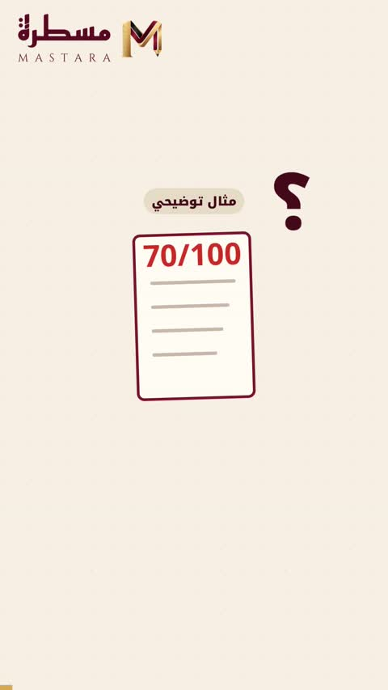 |
| 2 | [mastara-exp2-v1](videos/mastara-exp2-v1.mp4) | 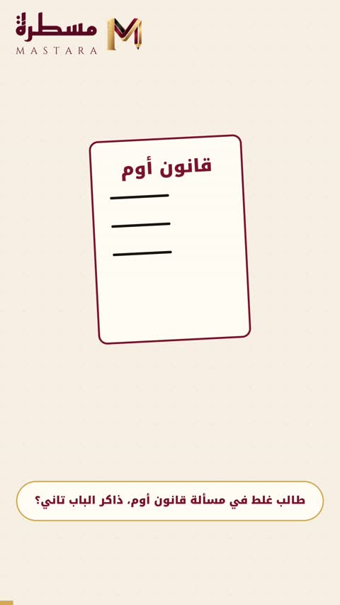 |
| 3 | [mastara-exp3-v1](videos/mastara-exp3-v1.mp4) | 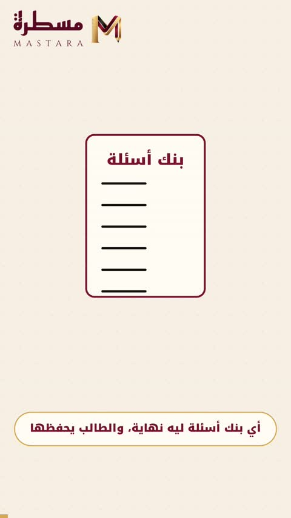 |
| 4 | [mastara-exp4-v1](videos/mastara-exp4-v1.mp4) | 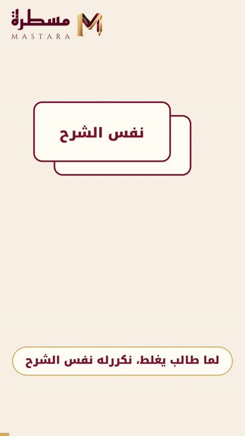 |
| 5 | [mastara-explainer-05-v1](videos/mastara-explainer-05-v1.mp4) | 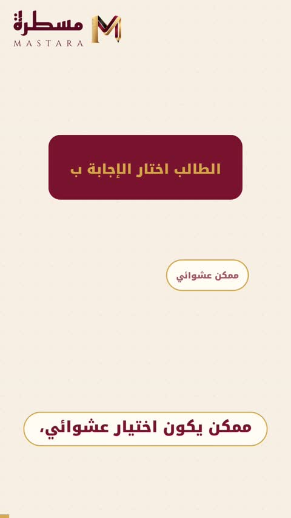 |
| 6 | [mastara-explainer-06-v1](videos/mastara-explainer-06-v1.mp4) | 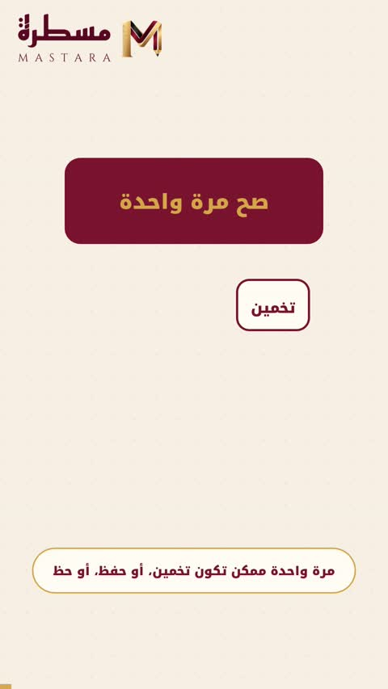 |
| 7 | [mastara-explainer-07-v1](videos/mastara-explainer-07-v1.mp4) | 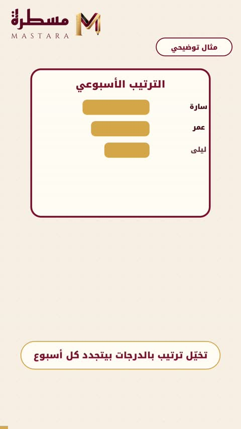 |
| 8 | [mastara-explainer-08-v1](videos/mastara-explainer-08-v1.mp4) | 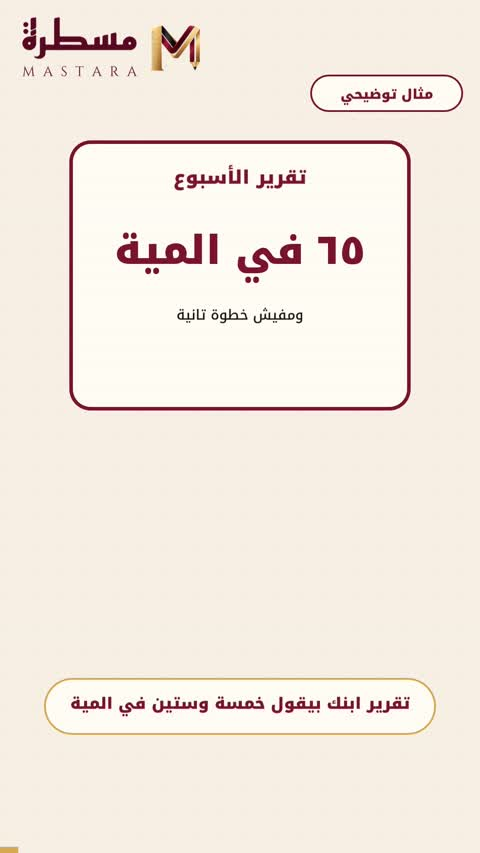 |
| 9 | [mastara-explainer-09-v1](videos/mastara-explainer-09-v1.mp4) | 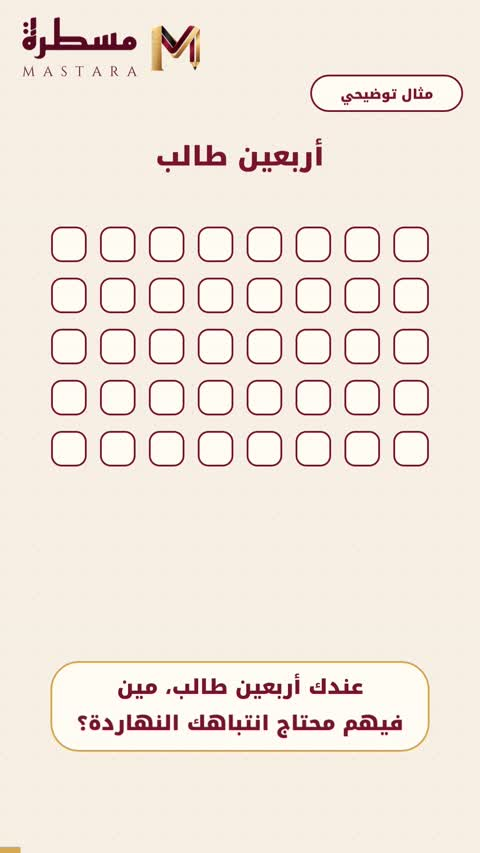 |
| 10 | [mastara-explainer-10-v2](videos/mastara-explainer-10-v2.mp4) | 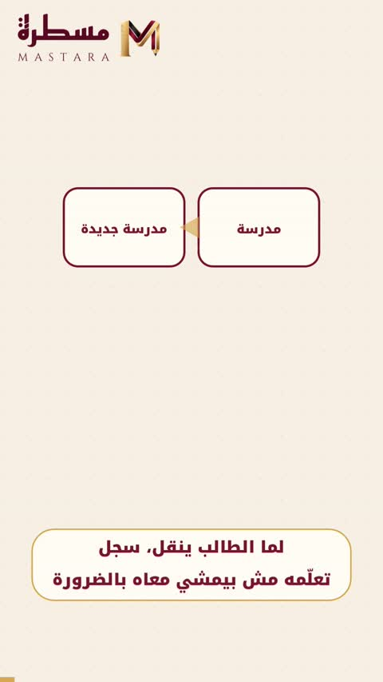 |
| 11 | [mastara-sc-closing-v1](videos/mastara-sc-closing-v1.mp4) | 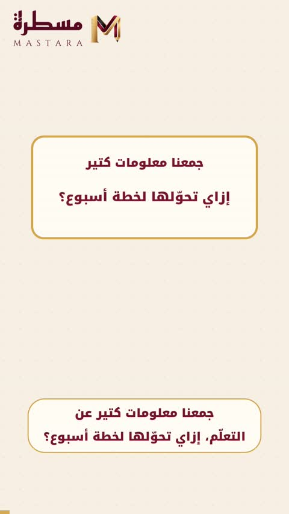 |
| 12 | [mastara-sc-generation-v1](videos/mastara-sc-generation-v1.mp4) | 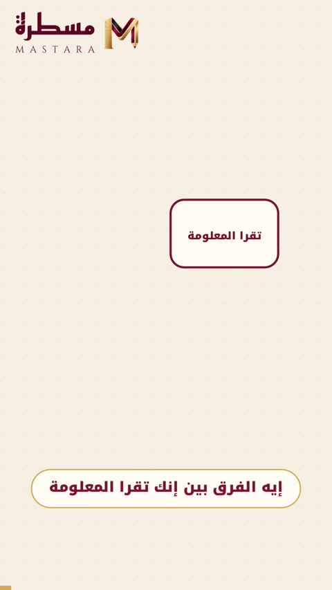 |
| 13 | [mastara-sc-hypercorrection-v2](videos/mastara-sc-hypercorrection-v2.mp4) | 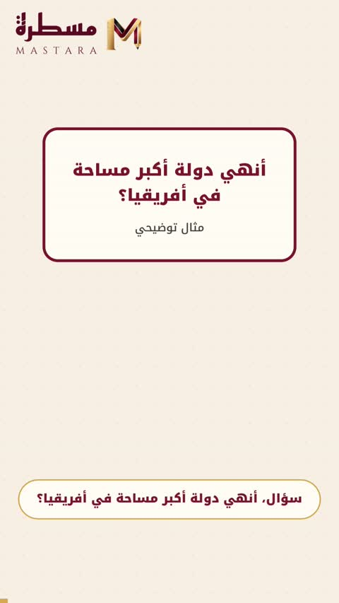 |
| 14 | [mastara-sc-interleaving-v2](videos/mastara-sc-interleaving-v2.mp4) | 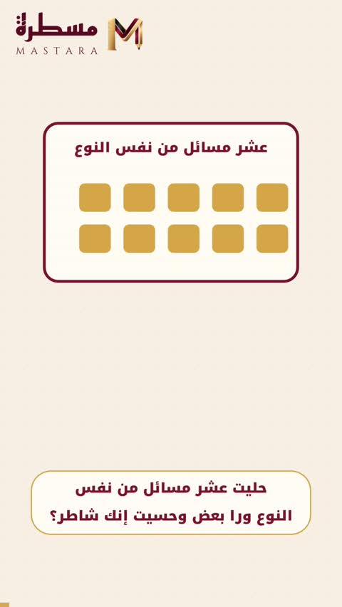 |
| 15 | [mastara-sc-pretesting-v1](videos/mastara-sc-pretesting-v1.mp4) | 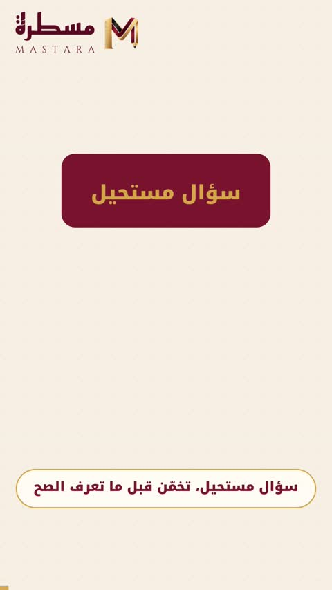 |
| 16 | [mastara-sc-sleep-v1](videos/mastara-sc-sleep-v1.mp4) | 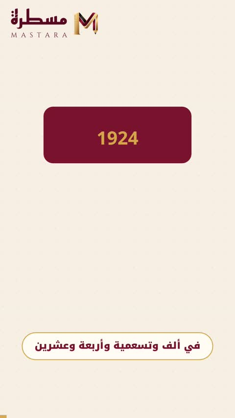 |
| 17 | [mastara-sc-spacing-v1](videos/mastara-sc-spacing-v1.mp4) | 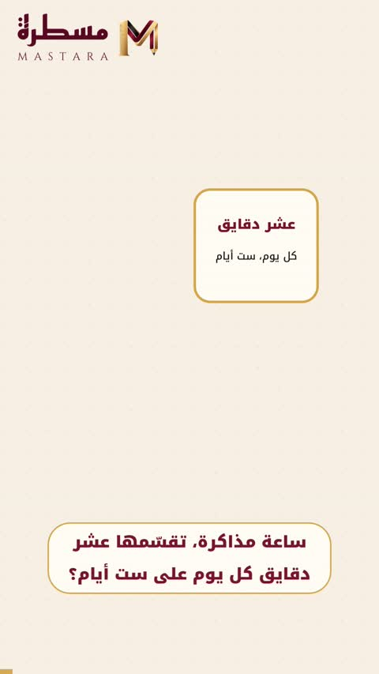 |
| 18 | [mastara-sc02-v1](videos/mastara-sc02-v1.mp4) | 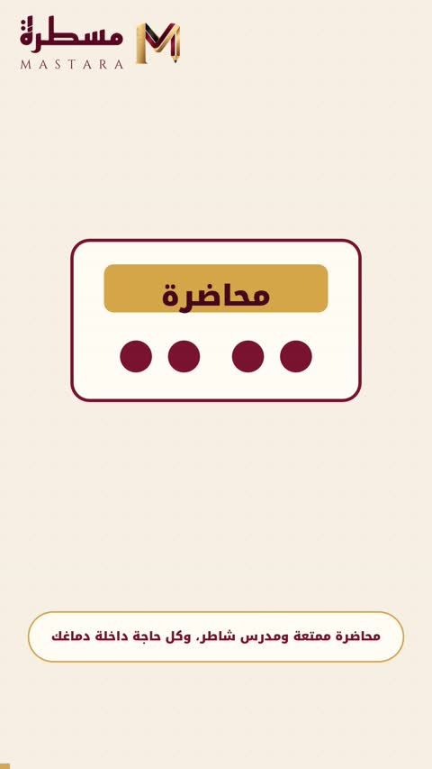 |
| 19 | [mastara-sc03-v1](videos/mastara-sc03-v1.mp4) | 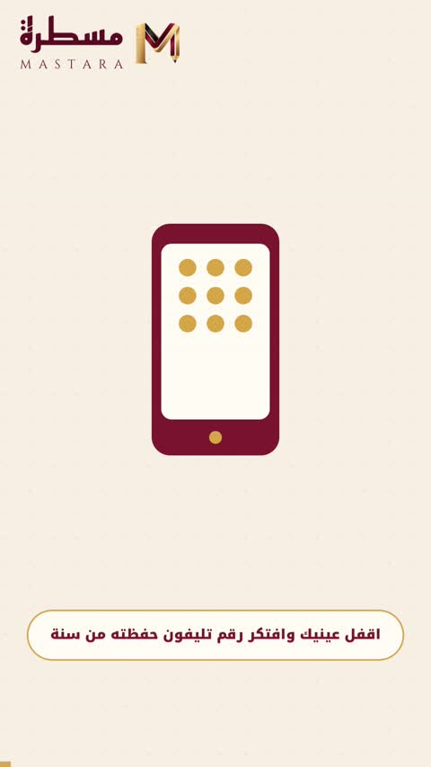 |
| 20 | [mastara-ts-ep-v2](videos/mastara-ts-ep-v2.mp4) | 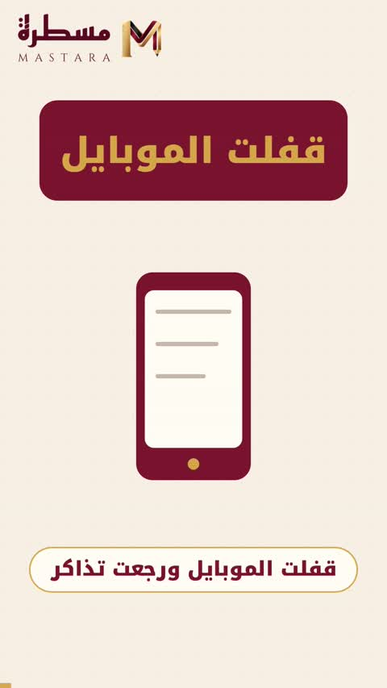 |

## Website screenshots (Mastara, in development)
Arabic RTL website with dark and light themes, Arabic/English switch and a multi-step registration for six account types.

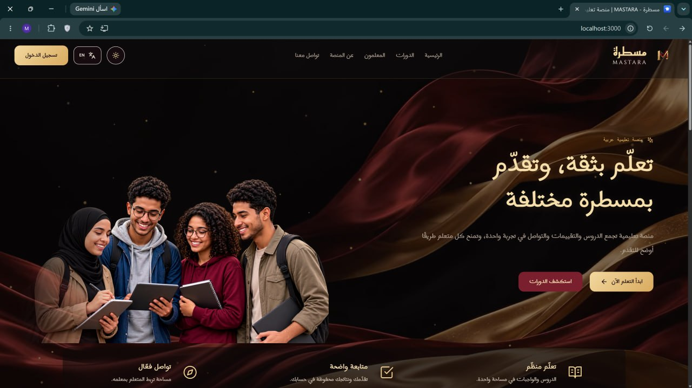
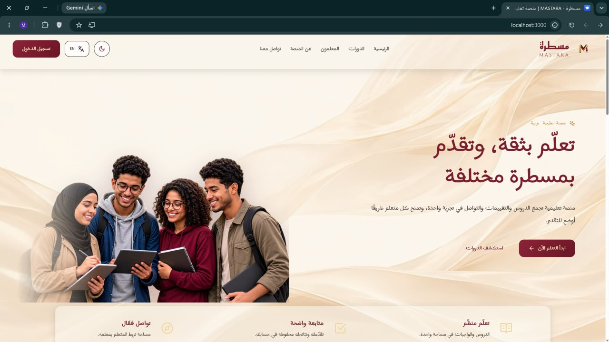
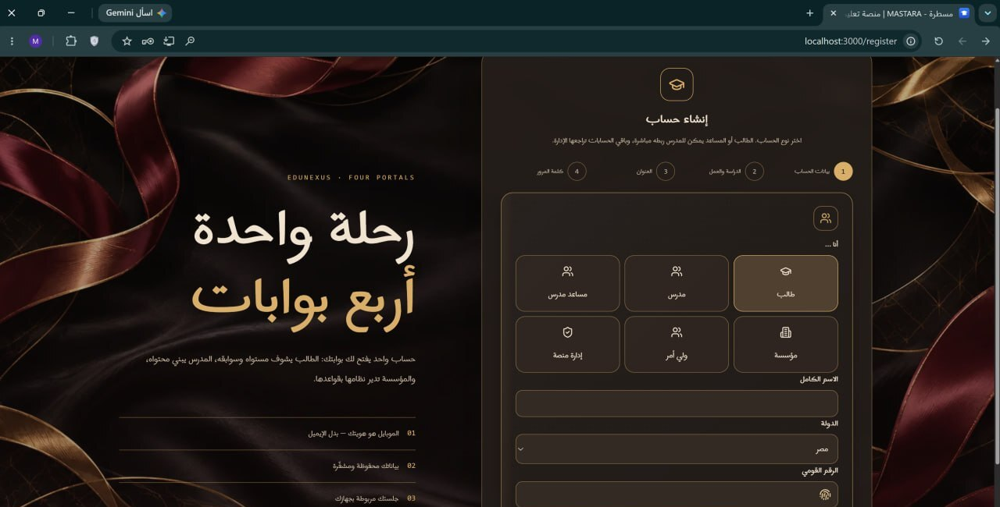

## Mastara in short (English)
Mastara is an Arabic educational website for students and their parents. Students get short daily practice and an error log that brings back forgotten topics; parents get a simple progress summary. I designed the brand, the videos and the launch ad (60s and 15s, 9:16).

## مسطرة باختصار (عربي)
مسطرة موقع تعليمي عربي للطلاب وأولياء الأمور. الطالب بيحصل على تدريب يومي قصير وسجل أخطاء بيرجّع له المواضيع اللي نسيها، وولي الأمر بيحصل على ملخص بسيط للتقدم. صممت الهوية والفيديوهات وإعلان الإطلاق (60 ثانية و15 ثانية، 9:16).
